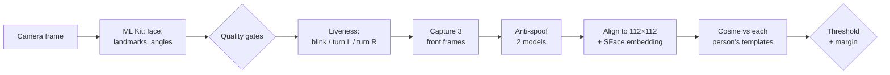

# Face Verify

**On-device face enrollment and identification for Android, with liveness and anti-spoofing.**
Several people can be enrolled on one phone. A face check tells you who is in front of the camera,
if anyone, and refuses photos and screen replays. All processing runs on the device.

[](#getting-started)
[](#tech-stack)
[](#tech-stack)
[-FF6F00)](#models)

Built by **SumOn** · [sumonlogs.com](https://sumonlogs.com)

<!--
Screenshots: add images under docs/screenshots/ and show them here, for example:
<p align="center"> </p>
-->

## What it does

- **Multi-person identification (1:N).** Enroll several people by name; a face check returns who was
  recognised. If two people score too close to call, it says so instead of guessing.
- **Active liveness.** Each check asks for a random challenge: blink, turn left or turn right.
- **Passive anti-spoofing.** Two MiniFASNet models look at the face and its surroundings to reject
  printed photos and screen replays, even when the challenge was performed.
- **Quality gating.** Frames are rejected for a small, off-centre or tilted face, closed eyes, and
  dark, bright or blurry crops, and the user is told why. Hints appear only when a problem lasts
  (no flashing on a single dark frame), and the screen stays on at full brightness while capturing.
- **Private by design.** Only embeddings and names are stored, encrypted with a non-exportable
  Android Keystore key. No face images are kept.
- **Two languages.** English and Bengali.
- **A test app.** Switch models, tune the threshold, label checks to calibrate, and watch live timings.

## How a face check works



1. **Enrollment** captures 5 front-facing frames and stores their embeddings. Turning left and right
   is a liveness check only, and those frames are not stored. The same tracked face must stay in
   view throughout, and a face that is already enrolled is refused.
2. **Alignment.** Each crop is aligned with a least-squares fit on 5 landmarks (eyes, nose, mouth
   corners) to the ArcFace 112×112 template.
3. **Verification** averages the embeddings of 3 front frames after the liveness challenge and
   compares them with the average of each person's templates.
4. **Decision.** The best person must reach the model's threshold *and* beat the runner-up by
   `FaceConfig.identifyMargin`; otherwise the result is `AmbiguousMatch`.
5. **Anti-spoofing runs first.** A face scored as fake is never embedded.

The slow part (anti-spoofing, embedding, matching) runs on a worker thread, not the camera thread,
after models are warmed up in the background.

## Models

| Model | Role | Licence |
|---|---|---|
| [SFace](https://github.com/opencv/opencv_zoo/tree/main/models/face_recognition_sface) (OpenCV Zoo), default | Face embedding (128-d) | Apache-2.0 |
| MobileFaceNet (converted from [sirius-ai](https://github.com/sirius-ai/MobileFaceNet_TF)), optional | Face embedding (192-d) | Code Apache-2.0; **weights are research-only, get a legal review before commercial use** |
| [MiniFASNet](https://github.com/minivision-ai/Silent-Face-Anti-Spoofing) 2.7× and 4.0× | Anti-spoofing | Apache-2.0 |
| ML Kit Face Detection (bundled) | Detection, landmarks, head angles, eye-open probability | Google ML Kit terms |

Embeddings from different models can't be compared, so each enrollment records its model and only
the active model's people are matched. Sources, hashes and licence texts are in the NOTICE files in
`app/src/main/assets/`.

## Tech stack

| Area | Choice |
|---|---|
| Language / UI | Kotlin 2.2, Jetpack Compose, Material 3 |
| Camera | CameraX 1.4 |
| ML runtime | LiteRT 1.4 (TensorFlow Lite) on CPU, ML Kit face detection 16.1 |
| Architecture | MVI view models, Koin dependency injection, a pure Kotlin engine with no Android types |
| Storage | DataStore + AES-256-GCM with an Android Keystore key |
| Build | AGP 9.4, R8 in release, baseline profile, `minSdk 27` |

## Architecture

```
app/src/main/java/com/sumonlogs/faceverify/
├── core/
│   ├── api/      public API: FaceVerifier, enrollment graph, settings, diagnostics
│   ├── engine/   pure logic: alignment, matching, quality, liveness, sessions (unit-tested)
│   │   └── android/   CameraX analyzer, ML Kit, LiteRT embedder and spoof detector, Keystore store
│   ├── ui/       Compose screens: enrollment, face check, camera preview, components, theme
│   ├── di/       Koin module (load faceModule to use the feature)
│   └── mvi/      small MVI base
├── harness/      test app: model switch, threshold, calibration, performance, debug panel
└── MainActivity.kt
```

The engine takes plain numbers and arrays, so sessions, matching and quality checks are covered by
JVM unit tests without a device. Camera frames are wrapped behind a small `FaceFrame` interface.

## Security and privacy

- Names and embeddings are encrypted at rest (AES-256-GCM, non-exportable Keystore key). No face
  images are stored. The selfie of a check is only returned to the caller and is never written to disk.
- The app contains no networking code, and no face data is sent anywhere. Some Google libraries
  declare the `INTERNET` permission in the merged manifest; remove it with a manifest merge rule if
  you need to enforce an offline app.
- Backup is disabled for the template store, because the Keystore key can't be restored.

## Performance and size

- Release builds use R8 and ship a baseline profile. Models are loaded and warmed up in the background
  when the enrollment or camera screen opens.
- A release APK with `arm64-v8a` and `armeabi-v7a` is about **65 MB** (models are about 41 MB of that).
- The test app has a **Performance** card with per-stage average and p95 timings (detection, frame
  conversion, alignment, each anti-spoof model, embedding) and a thread benchmark. Use a release build
  to read it. Per-device numbers are not published yet.

## Getting started

Requires Android Studio with a recent Android SDK, JDK 17 and a phone or emulator with a camera
(Android 8.1 or newer).

```bash
./gradlew :app:assembleDebug        # debug build
./gradlew :app:testDebugUnitTest    # unit tests
./gradlew :app:lintDebug            # lint
./gradlew :app:assembleRelease      # R8 + baseline profile (unsigned; sign it to install)
```

The launcher activity is the test app: enroll a person, run a check, and read the debug panel.

## Calibrating the threshold

Starting thresholds are guesses (SFace 0.42, MobileFaceNet 0.65), and the anti-spoof cut-off
(`spoofMinScore`, 0.5) is the model's own decision point. In the test app, label every check with who
was really in front of the camera; the calibration card shows how many strangers got in and how many
right people were refused at the current threshold, and suggests one. Test with several people,
different light, glasses on and off, and people who look alike.

## Reusing the feature in another app

| What | Where |
|---|---|
| Code | `app/src/main/java/com/sumonlogs/faceverify/core/` (whole folder) |
| Strings | `res/values/face_strings.xml`, `res/values-bn/face_strings.xml` |
| Resources | `res/values/face_colors.xml`, style `Theme.FaceVerify.FaceCheck` in `res/values/themes.xml` |
| Models | `assets/SFace.tflite`, `assets/spoof_model_scale_2_7.tflite`, `assets/spoof_model_scale_4_0.tflite` and their NOTICE files; optionally `assets/MobileFaceNet.tflite`. Keep `noCompress += 'tflite'` |
| Manifest | `CAMERA` permission, the two non-required camera `uses-feature`s, the ML Kit `DEPENDENCIES` meta-data and the `FaceCheckActivity` entry |
| Backup | exclude `datastore/face_templates.preferences_pb` (see `res/xml/*_rules.xml`) |
| Dependencies | CameraX 1.4.2 (core, camera2, lifecycle, view), `com.google.mlkit:face-detection:16.1.7`, `com.google.ai.edge.litert:litert:1.4.1` |
| Release | the R8 rules in `src/main/keepRules/rules.keep` (LiteRT must be kept) |

Then load `faceModule` in Koin.

### Public API

- `FaceVerifier.enrolledFaces`: everyone enrolled (id, name, enrolment time), as a Flow.
- `FaceVerifier.verify()`: opens the camera flow and always returns a `FaceMatchResult` with the recognised person, if any.
- `FaceVerifier.deleteEnrollment(id)`: removes one person.
- `NavGraphBuilder.faceEnrollmentGraph(...)` / `FaceEnrollmentFlow(...)`: name → capture → done; enrolls one new person per run.
- `FaceModelSettings`: which model is active and its threshold (for testing and calibration).
- `FaceDiagnostics`: numbers and timings for a debug panel (optional).

## Status and roadmap

Working today: enrollment, 1:N identification, active liveness, two-model anti-spoofing, encrypted
storage, quality gating, a calibration test app, and release optimisation.

Next, in order:
1. An offline tool to measure false accepts and rejects per model and pick evidence-based thresholds.
2. Accuracy work: alignment checks against ML Kit's landmark conventions, stricter quality gates.
3. UX: overlap capture with the challenge, direction arrows and a countdown on the check screen,
   retry advice after a failure, accessibility.
4. Experiments: a cheaper anti-spoof cascade and a quantized embedding model, kept only if accuracy
   holds.

## Credits and licence

This project builds on SFace and the OpenCV Zoo, MiniFASNet from minivision-ai/Silent-Face-Anti-Spoofing,
MobileFaceNet from sirius-ai, and Google ML Kit, CameraX and LiteRT. Each model's licence is listed in
[Models](#models).

The project has no licence file yet, so it is all rights reserved until one is added.

## About

Made by **SumOn**. More projects and write-ups at **[sumonlogs.com](https://sumonlogs.com)**.
